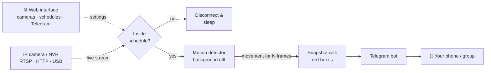

<div align="center">


# MotionWatch

**Turn the CCTV cameras you already own into a smart alarm - with photo alerts on your phone via Telegram.**

Runs quietly on any **Debian / Ubuntu / Raspberry Pi** box, only watches during the hours **you** choose, and is set up entirely **from your browser**.

[](https://github.com/bothamad/motionwatch/releases/latest)
[](https://github.com/bothamad/motionwatch/releases)
[](https://github.com/bothamad/motionwatch/actions/workflows/ci.yml)


[](https://ko-fi.com/drquashi)

</div>

---

## Why this exists

Most home and small-business CCTV systems record everything and tell you nothing. Their own "motion alerts"
are either missing, locked behind a cloud subscription, or so noisy you turn them off after a day. Full NVR
suites like Frigate, ZoneMinder or Shinobi are powerful but heavy to set up when all you want is
*"send me a picture when someone's in the driveway at night"*.

MotionWatch does exactly that and nothing more: it **connects to your cameras' existing streams**, watches for
movement **only inside your schedule**, and sends an **annotated snapshot to Telegram** - the moving area boxed in
red, with the camera name and time. Cameras, schedules and Telegram are all managed from a simple **web page** -
no config files to edit. No cloud account, no recording server, no subscription.

## How it works



## Common problems and what to do

| Problem | Cause | Fix |
|---|---|---|
| **Alerts every few minutes** from trees, shadows or rain | Sensitivity too high for that scene | Raise **Minimum size** (e.g. `3000`) and **Frames in a row** (e.g. `5`) for that camera |
| **A busy road** in the corner sets it off | Road is inside the frame | **Test connection** on the camera page and drag a box over the road |
| Alerts when **IR night mode switches on** at dusk | The whole picture changes brightness at once | Raise **Sensitivity threshold** to `35-40`; the detector re-learns the background within seconds |
| **High CPU** on a Raspberry Pi | Analysing the 4K main stream | Use the camera's **sub-stream** (e.g. Hikvision `/Streaming/Channels/102`, Dahua `subtype=1`) and/or raise **Check every** |
| Camera shows **Offline** | Wrong URL, password, or RTSP disabled on the camera | Use **Test connection** on the camera page; try the URL in VLC from the same network |
| Grey / smeared frames | UDP packet loss on Wi-Fi | Already handled - MotionWatch forces RTSP over **TCP** |
| **Find chats** shows nothing | Nobody has messaged the bot yet | Open your bot in Telegram, press **Start** (or add it to the group and say hi), then try again |
| Can't open the web page | Firewall, or wrong address | Check `sudo ss -ltnp` shows port 8080; with ufw run `sudo ufw allow 8080/tcp` |
| Forgot the admin password | - | `sudo motionwatch set-password`, then `sudo systemctl restart motionwatch` |
| Schedule is **an hour off** | Server clock in UTC | Pick your timezone on the **Settings** page |
| Nothing happens | Service not running | `sudo systemctl enable --now motionwatch`, then `journalctl -u motionwatch -f` |

## Quick start

1. **Install** the `.deb` from the [latest release](https://github.com/bothamad/motionwatch/releases/latest):
   ```sh
   wget https://github.com/bothamad/motionwatch/releases/latest/download/motionwatch_0.2.0_all.deb
   sudo apt install ./motionwatch_0.2.0_all.deb
   ```
   The service starts straight away and prints the web address and a one-time **setup code**.
2. **Open `http://<server-ip>:8080`** in your browser, enter the setup code and choose an admin password.
   (Lost the code? `sudo cat /var/lib/motionwatch/setup-code`)
3. **Telegram** page - create a bot with [@BotFather](https://t.me/BotFather), paste the token, send your bot a
   message, press **Find chats**, then **Send test message**.
4. **Cameras** page - **Add camera**, paste the stream URL, username and password, press **Test connection**.
   You'll see a live picture; drag on it to mark areas to ignore.
5. **Schedules** page - set when each camera is armed (or leave it on *Always*), then **Save & apply**.

Changes apply instantly - no restart needed. Forgot the password? `sudo motionwatch set-password`.

## Schedules

Each schedule is a set of time windows: pick the days, a start and an end time. A weekly bar chart on the
Schedules page shows exactly when it's armed.

- A window whose end is earlier than its start **runs past midnight** - *Mon 18:00 → 07:00* covers Monday evening
  and Tuesday early morning.
- The same start and end (*00:00 → 00:00*) means **the whole day**.
- Cameras on **Always** are armed 24/7.
- Outside its schedule a camera is fully disconnected - no bandwidth, no CPU.
- Set the **timezone** on the Settings page if the server's clock isn't in your local zone.

## Features

<table>
<tr><td width="50%">

**🌐 Managed from your browser**
Dashboard with live view, camera state, last motion and last alert picture. Add cameras, draw ignore zones,
edit schedules and connect Telegram - changes apply instantly. Works on your phone too.

**📷 Any camera with a stream**
RTSP and HTTP/MJPEG IP cameras, NVR/DVR channel streams (Hikvision, Dahua, Reolink, TP-Link Tapo, Uniview…) and
USB webcams. Auto-reconnect with back-off when a camera drops.

**🗓️ Weekly schedules**
Named schedules shared between cameras, overnight windows, per-camera assignment and an optional timezone.
`check-config` shows which cameras are armed right now.

**🎯 Fewer false alarms**
Adaptive background, minimum blob size, N-consecutive-frames rule, per-camera cooldown and ignore zones -
all tunable per camera.

</td><td width="50%">

**📲 Telegram photo alerts**
Annotated JPEG with red boxes, camera name and timestamp. Send to one person, several, or a group.
Handles Telegram rate limits and retries on network errors.

**🛡️ Runs as a proper service**
Debian package with a systemd unit, its own unprivileged user, sandboxing and automatic restart.
Logs go to the journal.

**🐳 Docker too**
Multi-arch (amd64 / arm64) image on GHCR for NAS boxes and home servers.
Optional on-disk copy of every alert image.

</td></tr>
</table>

## Tuning

| Setting | Default | What it does |
|---|---|---|
| Sensitivity threshold (`threshold`) | `25` | Brightness change (0-255) that counts as movement. Raise for noisy night video. |
| Minimum size (`min_area`) | `1500` | Smallest moving blob in px² (on a 640 px-wide copy of the frame). Raise to ignore cats and leaves. |
| Frames in a row (`min_motion_frames`) | `3` | Consecutive analysed frames with movement before alerting. |
| Cooldown (`cooldown_seconds`) | `60` | Minimum gap between two alerts from the same camera. |
| Check every (`frame_interval`) | `0.25` | Seconds between analysed frames - lower reacts faster, higher saves CPU. |
| Ignore zones (`ignore_regions`) | – | Drawn on the camera's picture. |
| Camera enabled (`enabled`) | on | Switch a camera off without deleting it. |

Set them for all cameras on the **Settings** page, or per camera under **Sensitivity (advanced)**.

## Commands

| Command | What it does |
|---|---|
| `motionwatch run` | Start monitoring and the web interface (what the service runs) |
| `motionwatch set-password` | Set or reset the web interface password |
| `motionwatch check-config` | Validate the config and show each camera's schedule state |
| `motionwatch test-telegram` | Send a test message to every configured chat |
| `motionwatch snapshot [camera]` | Send a live picture from one or all cameras |

Run them as the service user so they find the settings, e.g. `sudo -u motionwatch motionwatch check-config`.
Options: `-d DIR` data directory, `--web HOST:PORT`, `--no-web`, `-v` debug logging.

## Docker

```sh
docker run -d --name motionwatch --restart unless-stopped \
  -p 8080:8080 -v $PWD/data:/data \
  ghcr.io/bothamad/motionwatch:latest
docker logs motionwatch    # shows the setup code
```

Then open `http://<host>:8080`. Or use the included [docker-compose.yml](docker-compose.yml).

## Safe by design

- **Your images stay yours.** Pictures go only to the Telegram chats you configure - no MotionWatch server,
  no cloud account, no telemetry.
- **Password-protected web interface.** Admin password stored as a salted scrypt hash, first-run setup needs a
  one-time code from the server, repeated wrong passwords are throttled, sessions use `HttpOnly`/`SameSite=Strict`
  cookies and every change is protected against cross-site requests.
- **Secrets stay on the server.** The bot token and camera passwords are never sent back to the browser, are
  **redacted from every log line**, and the settings file is readable by the service only (`0600`).
- **Keep it on your LAN.** Don't port-forward 8080 to the internet. For remote access use a VPN, or a reverse
  proxy with HTTPS and set `MOTIONWATCH_WEB_LISTEN=127.0.0.1:8080` in `/etc/motionwatch/motionwatch.env`.
- **Least privilege.** The service runs as its own `motionwatch` user with systemd hardening
  (`ProtectSystem=strict`, `NoNewPrivileges`, no home access) and can only write to `/var/lib/motionwatch`.
- **Read-only on your cameras.** MotionWatch only reads the video stream - it never changes camera settings.
- **Verified releases.** Every release ships with `SHA256SUMS`, built by GitHub Actions from the tagged source.

> MotionWatch is a convenience tool, not a certified alarm system. Don't rely on it as your only protection.

## Updating

Download the new `.deb` from [releases](https://github.com/bothamad/motionwatch/releases) and install it over the
old one - your settings and password are kept and the service restarts itself.
Upgrading from 0.1.x moves `/etc/motionwatch/config.yaml` into `/var/lib/motionwatch/` automatically.
What changed is in the release notes and [CHANGELOG.md](CHANGELOG.md).

## Where things are kept

| Path | Contents |
|---|---|
| `/var/lib/motionwatch/config.yaml` | Cameras, schedules, Telegram and tuning (written by the web interface; hand edits are fine) |
| `/var/lib/motionwatch/auth.json` | Admin password hash |
| `/var/lib/motionwatch/snapshots/` | Alert pictures, if enabled on the Settings page |
| `/etc/motionwatch/motionwatch.env` | Web address (`MOTIONWATCH_WEB_LISTEN`) and optional `${VARIABLES}` |
| `/usr/lib/motionwatch/` | The program |
| `journalctl -u motionwatch` | Logs |

Remove with `sudo apt remove motionwatch`, or `sudo apt purge motionwatch` to delete settings and pictures too.

## Build from source

Requires Python 3.9+. The web interface is plain HTML/JS in `src/motionwatch/web/` - no build step.

```sh
git clone https://github.com/bothamad/motionwatch && cd motionwatch
pip install -e .[dev]
pytest
python -m motionwatch -d ./data --web 127.0.0.1:8080 run   # then open http://127.0.0.1:8080
```

Build the `.deb` yourself with [nfpm](https://nfpm.goreleaser.com/):

```sh
VERSION=0.1.0 nfpm package -f nfpm.yaml -p deb -t dist/
```

**Releasing:** bump `__version__` in `src/motionwatch/__init__.py`, update `CHANGELOG.md`, then
`git tag vX.Y.Z && git push --tags`. GitHub Actions tests, builds the `.deb`, wheel and sdist, test-installs the
`.deb` on Debian, publishes the release and pushes the Docker image.

## Support the project

MotionWatch is free. If it caught something you'd have missed and you'd like to say thanks,
you can buy me a coffee on Ko-fi:

<a href="https://ko-fi.com/drquashi"></a>

Bug reports, camera URL tips and pull requests are welcome. Security issues: see [SECURITY.md](SECURITY.md).

## Credits

- [OpenCV](https://opencv.org/) (Apache 2.0) - video capture and motion detection
- [FFmpeg](https://ffmpeg.org/) (LGPL) - RTSP/HTTP stream decoding
- [Telegram Bot API](https://core.telegram.org/bots/api) - alert delivery
- [PyYAML](https://pyyaml.org/) (MIT) and [Requests](https://requests.readthedocs.io/) (Apache 2.0)
- [nfpm](https://github.com/goreleaser/nfpm) (MIT) - Debian packaging

---

<sub>MIT licensed. Not affiliated with or endorsed by Telegram or any camera manufacturer. Camera brand names are
trademarks of their respective owners. Only monitor cameras and places you're allowed to - recording laws differ by
country.</sub>
